🇺🇦 LinkBox

Менше хаосу. Більше порядку. Усі посилання на своїх місцях.

Посилання зберігаються в браузері, месенджерах, нотатках і десятках інших місць. Згодом знайти потрібне стає справжньою археологічною експедицією.

LinkBox — це розумний органайзер посилань, який збирає все в одному місці та допомагає підтримувати порядок без зайвої метушні.

Можливості

- Швидке збереження. Додавання посилань, очищення URL та виявлення дублікатів.
- Порядок і структура. Категорії, папки, хештеги та кілька способів організації посилань.
- Контроль і пріоритети. Закріплення важливого, позначки непрочитаного та блокування посилань і папок.
- Потужний пошук. Пошук за назвою, доменом, описом, нотатками, папками та тегами.
- Масові дії. Керування кількома посиланнями одночасно.
- QR-коди. Створення QR-кодів для посилань.
- Приватний контент. Окрема категорія 18+ та додатковий захист.
- Офлайн-можливості. Черга операцій для роботи без постійного підключення до мережі.
- Історія активності. Календар, який допомагає відстежувати роботу з посиланнями.

Інтерфейс і зручність

LinkBox має світлу, темну та OLED-теми, налаштування розміру шрифту, різні режими відображення карток, жести керування, висувне меню та мобільну навігацію.

Підтримуються можливості PWA та передавання посилань через системне меню «Поділитися» на сумісних пристроях.

Дані та резервні копії

Дані зберігаються локально в IndexedDB. Для базового використання не потрібен обліковий запис у хмарному сервісі.

Передбачено імпорт закладок браузера у форматі HTML, експорт HTML та JSON, а також створення резервних копій і перенесення даних.

LinkBox — маленький органайзер для великого інтернету.

Telegram
https://t.me/linkbox_slo

<table>
  <tr>
    <td width="50%"><a href="images/LinkBoxPugPreview1.png">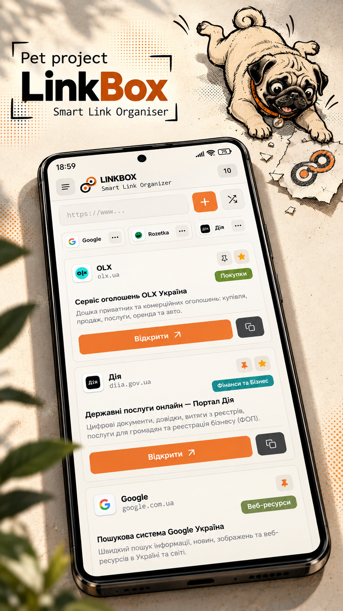</a></td>
    <td width="50%"><a href="images/LinkBoxPugPreview2.png">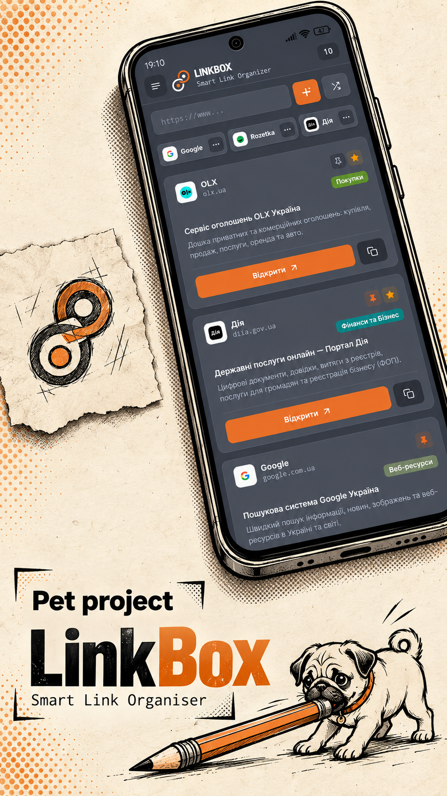</a></td>
  </tr>
  <tr>
    <td><a href="images/LinkBoxPugPreview3.png">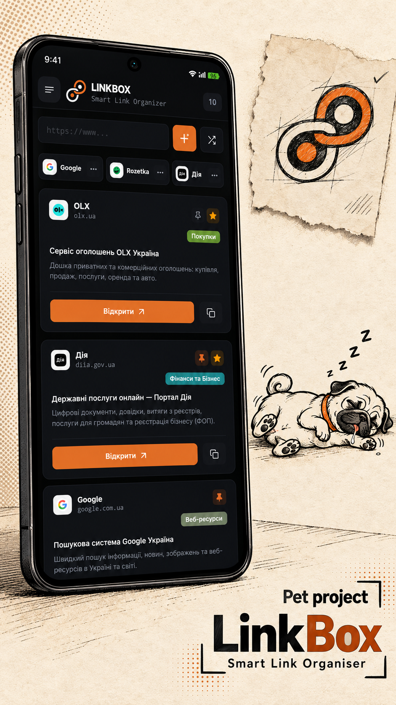</a></td>
    <td><a href="images/LinkBoxPugPreview4.png">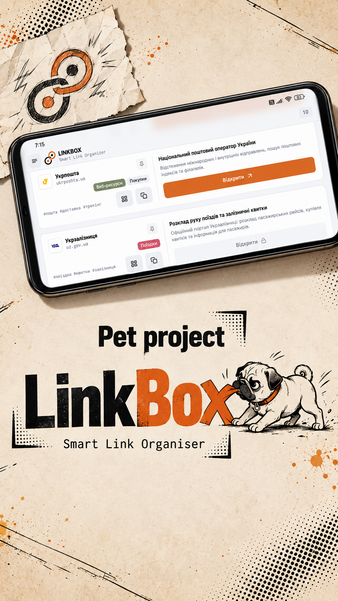</a></td>
  </tr>
  <tr>
    <td><a href="images/LinkBoxPugPreview5.png">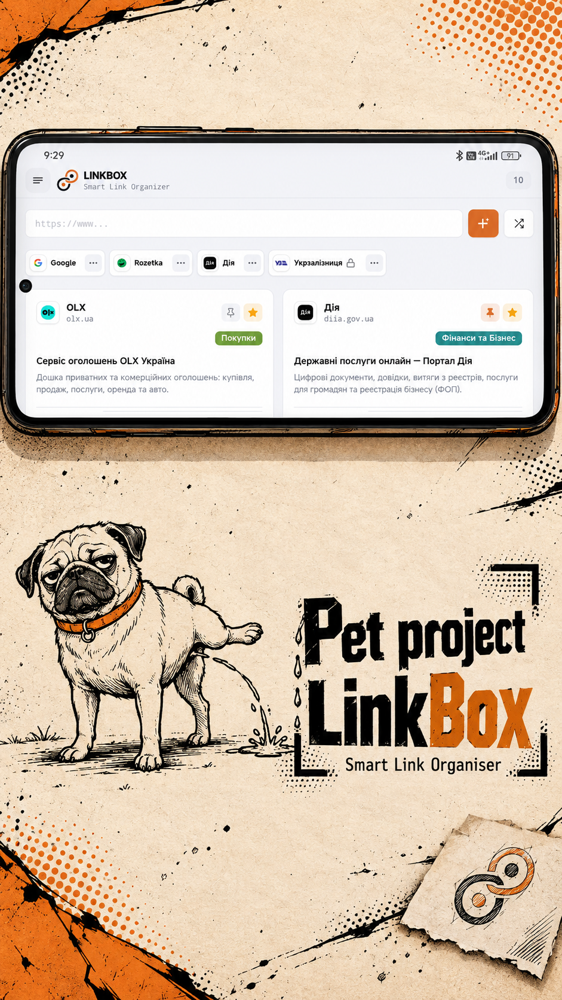</a></td>
    <td><a href="images/LinkBoxPugPreview6.png">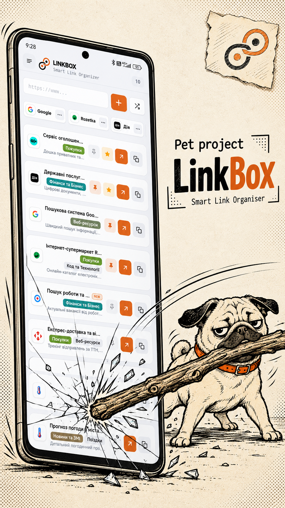</a></td>
  </tr>
  <tr>
    <td><a href="images/LinkBoxPugPreview7.png">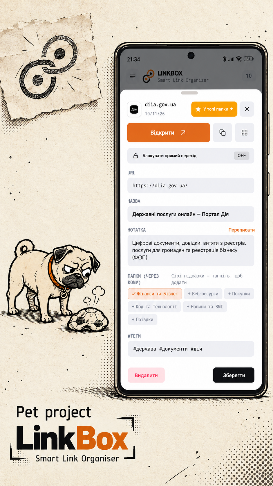</a></td>
    <td><a href="images/LinkBoxPugPreview8.png">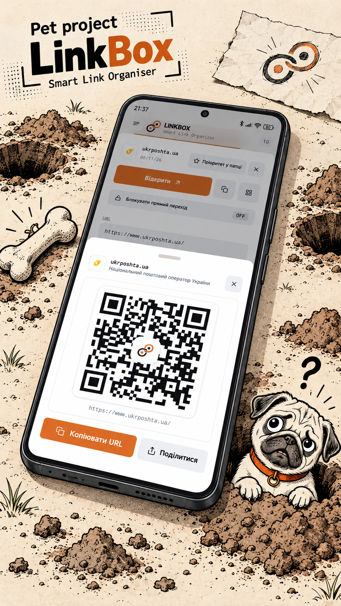</a></td>
  </tr>
  <tr>
    <td><a href="images/LinkBoxPugPreview9.png">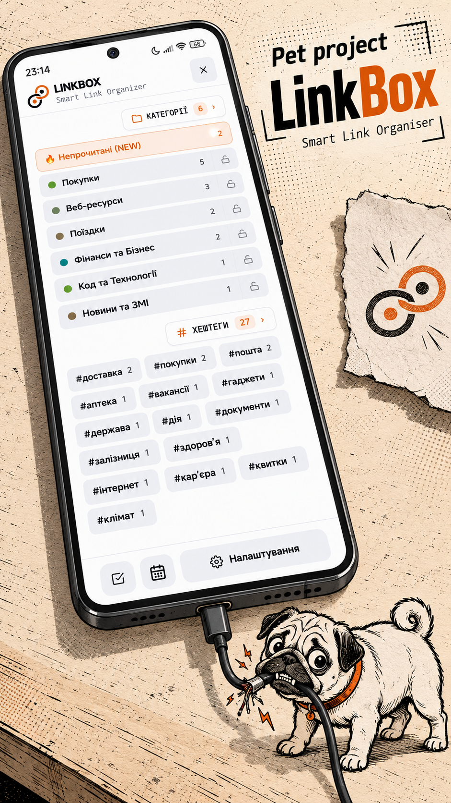</a></td>
    <td><a href="images/LinkBoxPugPreview10.png">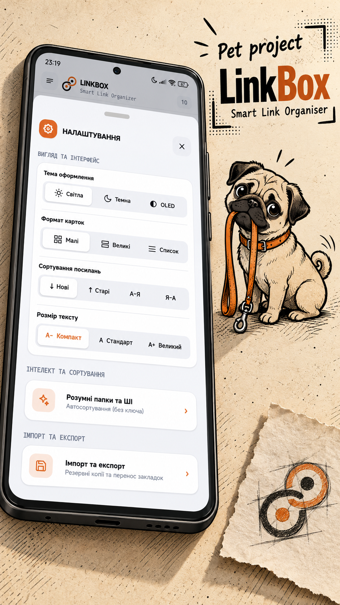</a></td>
  </tr>
  <tr>
    <td></td>
    <td><a href="images/LinkBoxPugPreview12.png">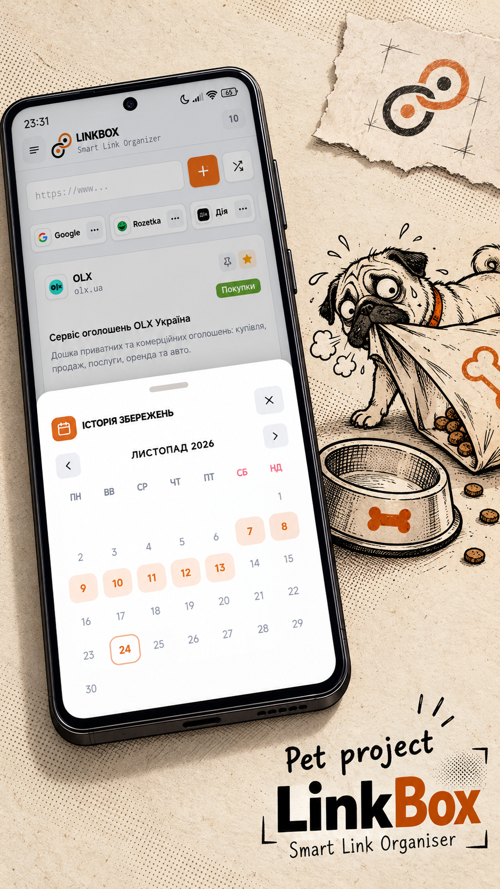</a></td>
  </tr>
  <tr>
    <td><a href="images/LinkBoxPugPreview13.png">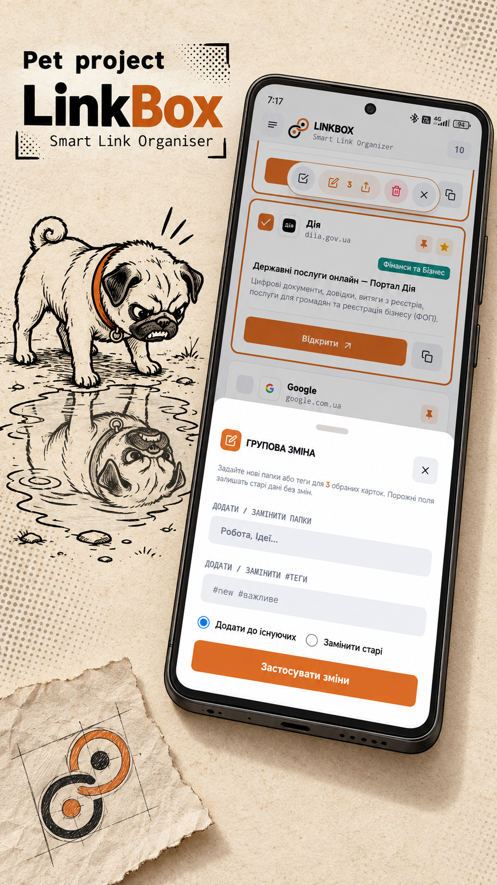</a></td>
    <td><a href="images/LinkBoxPugPreview14.png">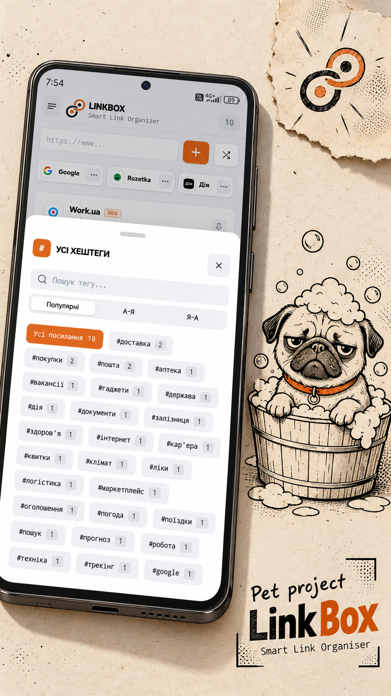</a></td>
  </tr>
</table>

🇬🇧 LinkBox

Less clutter. More order. Every link in its place.

Links end up everywhere: browsers, messengers, notes, and countless other places. Eventually, finding the one you need turns into a full-scale archaeological expedition.

LinkBox is a smart link organizer that brings everything together and helps keep it neatly organized without unnecessary hassle.

Features

- Quick saving. Add links, clean up URLs, and detect duplicates.
- Flexible organization. Categories, folders, hashtags, and multiple ways to organize your collection.
- Priorities and control. Pin important links, mark unread items, and lock links or folders.
- Powerful search. Search by title, domain, description, notes, folders, and tags.
- Bulk actions. Manage multiple links at once.
- QR codes. Generate QR codes for links.
- Private content. A separate 18+ category with additional protection.
- Offline capabilities. An operation queue for situations without a constant internet connection.
- Activity history. A calendar for tracking link activity.

Interface and usability

LinkBox includes light, dark, and OLED themes, font size settings, different card display modes, gesture controls, a slide-out menu, and mobile navigation.

PWA capabilities and sharing links through the system Share menu are supported on compatible devices.

Data and backups

Data is stored locally in IndexedDB. No cloud account is required for basic use.

LinkBox supports importing browser bookmarks in HTML format, exporting HTML and JSON, creating backups, and transferring data.

LinkBox — a little organizer for a very big internet.

Telegram
https://t.me/linkbox_slo
