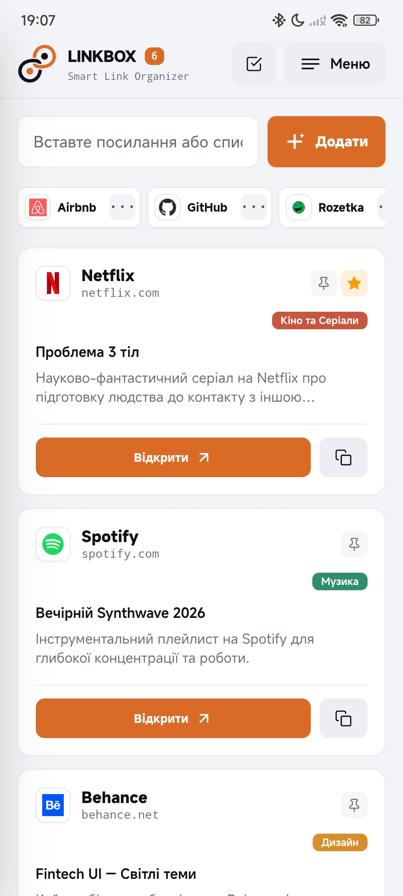
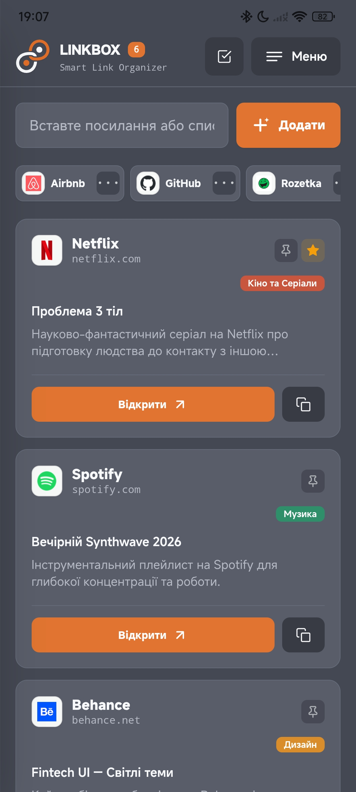
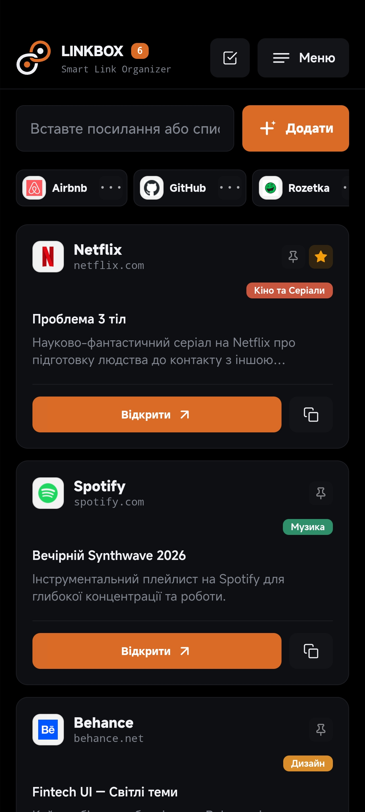
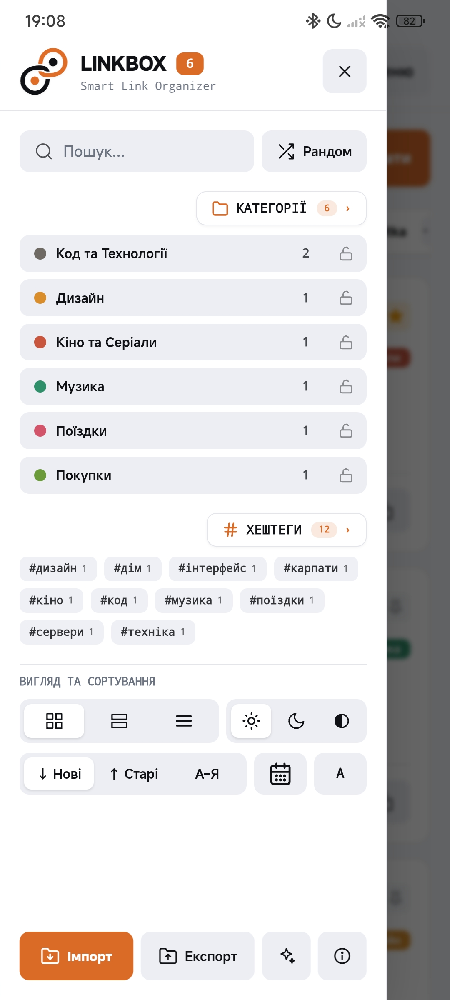
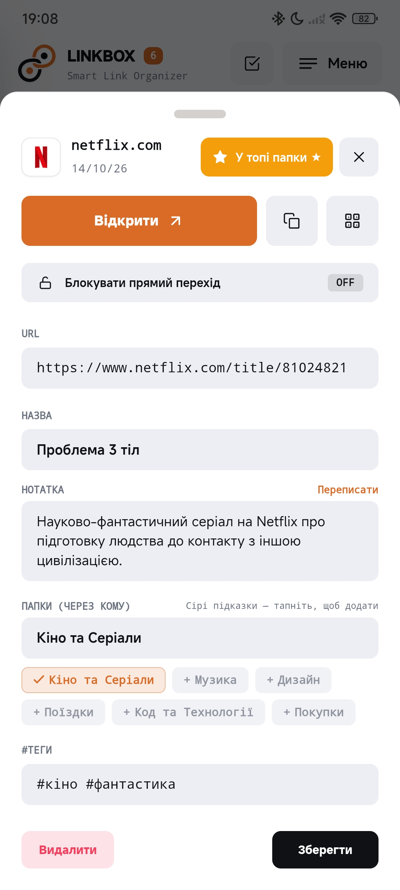

LinkBox — Smart Link Organizer

🇺🇦 Українська

LinkBox — розумний органайзер посилань для зручного збереження, сортування та керування закладками. Він поєднує гнучку систему категорій, хештеги, пошук та AI-класифікацію, допомагаючи підтримувати порядок навіть у великій колекції посилань.

✨ Основні можливості

- Категоризація: папки, категорії та хештеги. Одне посилання може належати до кількох категорій.
- AI-класифікація: автоматичне визначення категорій із можливістю використання зовнішніх AI-провайдерів. Передбачено локальний алгоритм як альтернативу.
- Пошук і фільтрація: швидке знаходження потрібних посилань.
- Гнучке відображення: компактні картки, великі картки або список.
- Керування посиланнями: закріплення, блокування, масове редагування, видалення та поширення.
- QR-коди: створення QR-коду для будь-якого посилання.
- Додаткові інструменти: випадкове посилання, історія додавання та іконки сайтів.
- Резервне копіювання: імпорт та експорт даних у JSON, експорт закладок у HTML.
- Персоналізація: світла, темна та AMOLED-теми, налаштування розміру шрифту й сортування.

🧠 Розумна класифікація

LinkBox може використовувати AI для аналізу назви сторінки, її опису та домену, щоб запропонувати відповідну категорію. Також система враховує наявні категорії та може адаптувати локальні правила до ручних змін користувача.

💾 Зберігання та приватність

Дані зберігаються локально у браузері за допомогою IndexedDB. Передбачено резервне копіювання та відновлення колекції. Для AI-класифікації із зовнішнім провайдером відповідні дані сторінки передаються цьому сервісу.

🚀 Запуск

1. Завантажте файл "LinkBox3.html".
2. Відкрийте його у сучасному браузері.
3. Почніть додавати та впорядковувати посилання.

Для використання зовнішньої AI-класифікації потрібно налаштувати провайдера та API-ключ.

🛠 Технології

HTML, CSS, JavaScript, IndexedDB.

---

🇬🇧 English

LinkBox is a smart link organizer designed to save, sort, and manage bookmarks efficiently. It combines flexible categories, hashtags, search, and AI-powered classification to keep even large link collections organized.

✨ Key Features

- Categorization: folders, categories, and hashtags. A single link can belong to multiple categories.
- AI Classification: automatic category suggestions using external AI providers, with a built-in local fallback.
- Search & Filtering: quickly find the links you need.
- Flexible Views: compact cards, large cards, or list layout.
- Link Management: pinning, locking, bulk editing, deletion, and sharing.
- QR Codes: generate QR codes for individual links.
- Extra Tools: random link selection, activity history, and website favicons.
- Backup & Export: JSON import/export and HTML bookmark export.
- Customization: light, dark, and AMOLED themes, font scaling, and sorting options.

🧠 Smart Classification

LinkBox can use AI to analyze a page's title, description, and domain to suggest an appropriate category. The system also considers existing categories and can adapt its local classification rules based on manual user changes.

💾 Storage & Privacy

Data is stored locally in the browser using IndexedDB. Backup and restore functionality is available. When an external AI provider is used, relevant page information is sent to that service for classification.

🚀 Getting Started

1. Download "LinkBox3.html".
2. Open it in a modern browser.
3. Start adding and organizing your links.

External AI classification requires a configured provider and API key.

🛠 Technologies

HTML, CSS, JavaScript, IndexedDB.
