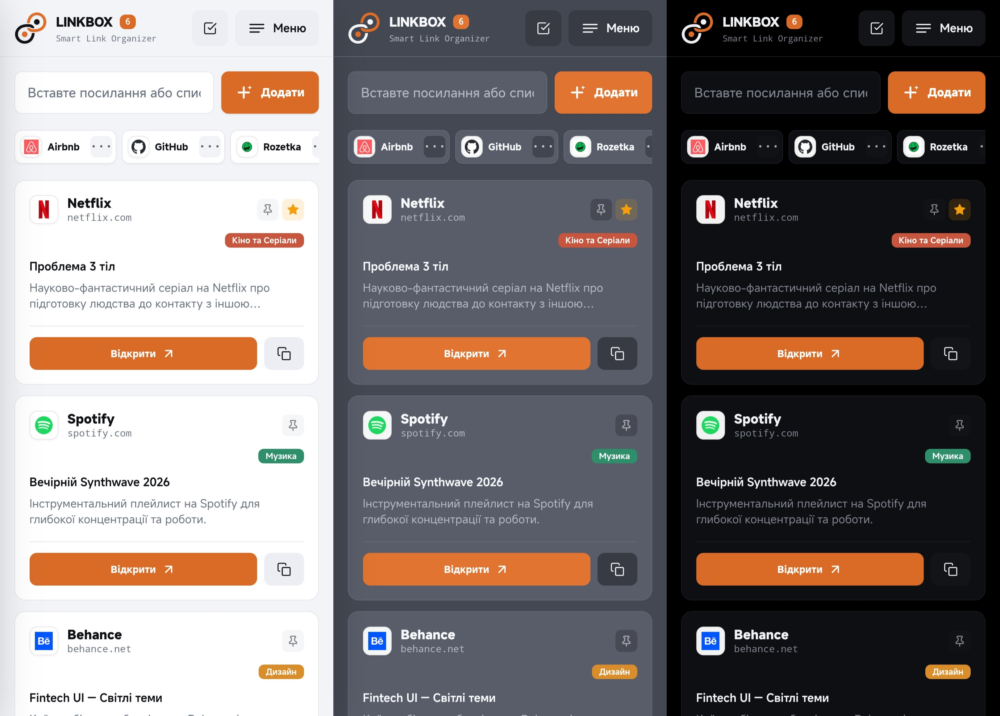
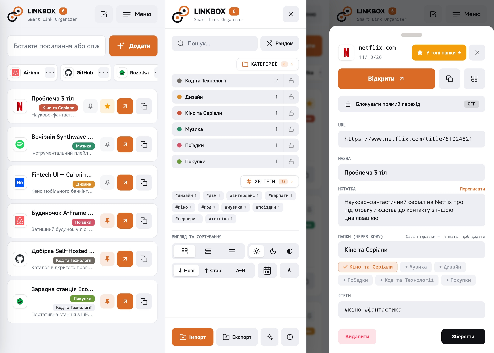

# LinkBox - Smart Link Organiser 

Android-додаток для тих, хто зберігає посилання «на потім», а потім ніколи їх не відкриває.

Без реєстрації, без хмари, без «увійдіть через Google». Поставив — і все. Дані лежать на телефоні і нікуди самі не втікають.

Кидаєш одне посилання чи цілий список — додаток сам намагається зрозуміти, що це за сайт, і кидає в нормальну папку. Можна додати свої категорії, навішати хештеги, закріпити важливе зверху, щоб не шукати потім по всьому списку. Є нормальний пошук, сортування і навіть календар: можна глянути, що ти взагалі зберігав того дивного вівторка три тижні тому.

Без інтернету теж працює. Посилання просто чекають у черзі. З’явиться мережа — підтягне заголовки й описи. Нічого не губиться.

ШІ підключати не обов’язково. Є вбудовані правила, які цілком нормально справляються і ще й вчаться на твоїх правках. Але якщо захочеш розумніший розклад — можна підкинути ключ від Gemini, Groq, Mistral, OpenRouter і ще купи всього.

Три теми (включаючи нормальний чорний AMOLED, а не «сірий із претензією»), три вигляди карток, масове редагування, імпорт і експорт. З браузера, телеграма чи будь-якого іншого додатка можна кидати посилання напряму — воно одразу потрапляє в LinkBox.

Коротше, щоб закладки нарешті перестали бути місцем, куди все зникає і більше ніколи не знаходиться.
---
**Встановити**  
АПК → [Releases](https://github.com/13symbols/LinkBox/tree/main/releases)

---

# LinkBox - Smart Link Organiser 

An Android app for people who save links “for later” and then never open them again.

No sign-up, no cloud, no “continue with Google”. Install and that’s it. Data stays on the phone and doesn’t wander off on its own.

Throw in one link or a whole list — the app tries to figure ou what the site is and drops it into a decent folder. You can add your own categories, slap on hashtags, pin the important stuff to the top so you don’t have to dig through the entire list later. There’s proper search, sorting, and even a calendar: you can check what the hell you saved that weird Tuesday three weeks ago.

Works offline too. Links just sit in a queue. Internet comes back — it pulls titles and descriptions. Nothing gets lost.

AI is optional. Built-in rules do a solid job and even learn from your corrections. But if you want smarter sorting, you can drop in a key for Gemini, Groq, Mistral, OpenRouter and a bunch of others.

Three themes (including a proper AMOLED black, not some “almost black” gray), three card layouts, bulk editing, import and export. You can share links straight from the browser, Telegram or any other app — they land in LinkBox immediately.

In short: so your bookmarks finally stop being the place where things go to disappear forever.
---
**Install**  
APK → [Releases](https://github.com/13symbols/LinkBox/tree/main/releases)
